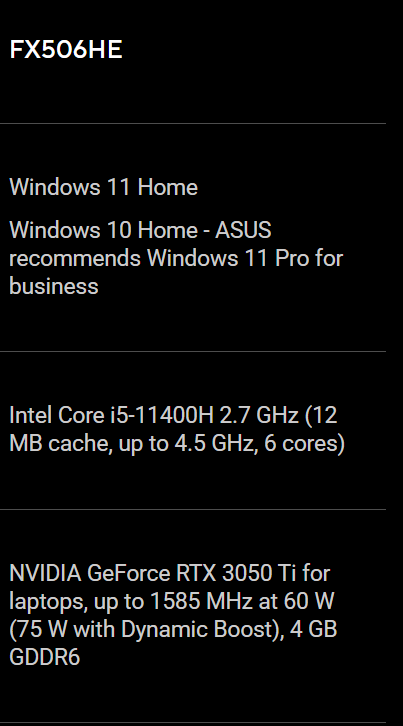

# Lab 3: Operating System Architecture

## 1. The Machine
- **Manufacturer:** ASUSTeK COMPUTER INC.
- **Model:** ASUS TUF Gaming F15 FX506HE
- **Manual / Specification Source:** [ASUS TUF Gaming F15 (2021) Tech Specs](https://www.asus.com/ru/laptops/for-gaming/tuf-gaming/2021-asus-tuf-gaming-f15/techspec/)
- **Note:** An official Hardware Maintenance Manual is not publicly available for this model. Technical specifications were verified using ASUS official tech specs and teardown guides.

---

## 2. Components

Below is the internal layout of the laptop with numbered components:

### Component Legend:
1. **SO-DIMM Memory Slots:**
   - **What:** 2x DDR4 SO-DIMM slots.
   - **Connects to:** CPU memory controller.
   - **Limits:** DDR4-3200 MHz, max 32 GB total (per ASUS specs).
2. **M.2 Storage Slots:**
   - **What:** 2x M.2 2280 NVMe PCIe 3.0 slots.
   - **Connects to:** System board PCIe bus.
   - **Limits:** Form factor M.2 2280, NVMe PCIe 3.0.
3. **Processor (CPU):**
   - **What:** Intel Core i5-11400H / i7-11800H.
   - **Connects to:** Soldered directly onto the system board (BGA).
   - **Limits:** BGA socket, non-upgradable.
4. **Wi-Fi Module:**
   - **What:** M.2 2230 Wi-Fi 6 card.
   - **Connects to:** M.2 A/E-key slot.
   - **Limits:** Form factor M.2 2230.
5. **Battery & Cooling System:**
   - **What:** Li-ion Battery (48Wh/90Wh) and Dual Fan Cooling.
   - **Connects to:** System board power connector and fan headers.
   - **Limits:** Battery capacity and thermal dissipation limits.

---

## 3. The Upgrade Verdict

| Component | Manual / Official Specs Say | OS Command Line Says | Upgrade Verdict |
| :--- | :--- | :--- | :--- |
| **Memory (RAM)** | 2x SO-DIMM DDR4 slots, max capacity 32 GB | `Win32_PhysicalMemory` shows SO-DIMM slots and installed modules | **Yes:** Upgradable, supports up to 32 GB DDR4-3200 (2x16 GB). |
| **Storage (Disk)** | 2x M.2 PCIe NVMe slots | `Get-PhysicalDisk` shows `BusType = NVMe` | **Yes:** Upgradable, can replace or add a second M.2 2280 NVMe SSD. |
| **Processor (CPU)** | BGA chip soldered onto the motherboard | `Win32_Processor` shows CPU details | **No:** CPU is soldered to the board (BGA), cannot be upgraded. |

---

## 4. Comparison Table (Host Windows vs Linux VM)

| Fact | Windows Field (Host) | Linux Field (Ubuntu VM) |
| :--- | :--- | :--- |
| **CPU Model** | `Win32_Processor` Name = Intel Core i5-11400H | `lscpu` Model name = Intel Core Processor (Haswell, no TSX) |
| **Physical Cores** | `Win32_Processor` NumberOfCores = 6 | `lscpu` Core(s) per socket = 2 |
| **Logical CPUs** | `Win32_Processor` NumberOfLogicalProcessors = 12 | `lscpu` CPU(s) = 2 |
| **Total Memory** | `Win32_ComputerSystem` TotalPhysicalMemory = ~16 GB | `free -h` total = ~4 GiB |
| **Memory Type/Speed** | `Win32_PhysicalMemory` Speed = 3200 MHz | `dmidecode` Type = RAM (Virtual) |
| **Disk Type** | `Get-PhysicalDisk` MediaType = SSD | `lsblk` ROTA = 0 |
| **Disk Interface** | `Get-PhysicalDisk` BusType = NVMe | `lsblk` TRAN = (empty in VM) |
| **Motherboard** | `Win32_BaseBoard` Product = FX506HE_FX506HE | `dmidecode` Product = VMware Virtual Platform |

### Analysis of Differences:
The command names and field representations differ significantly between Windows PowerShell and Linux bash. Windows uses CIM/WMI objects (`Win32_*` classes) with specific property names, while Linux uses utilities reading `/proc` and SMBIOS tables (`lscpu`, `free`, `lsblk`).

Furthermore, the Linux VM values reflect the hypervisor's allocated resources (virtual hardware) rather than the physical host specs. For instance, the disk interface field (`TRAN`) in Linux appears empty because virtualized SCSI/IDE controllers hide the underlying physical NVMe interface.
