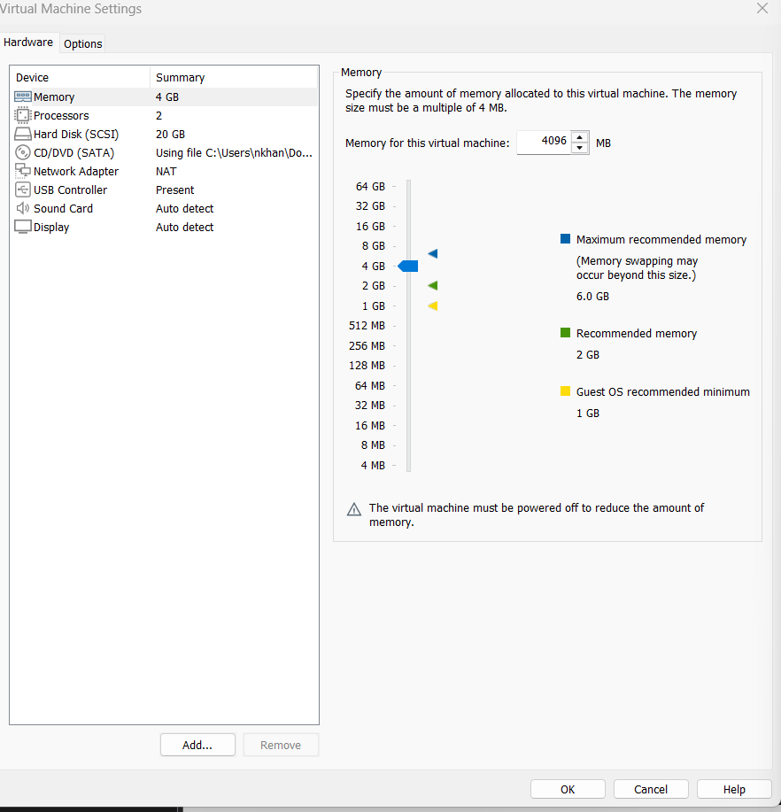
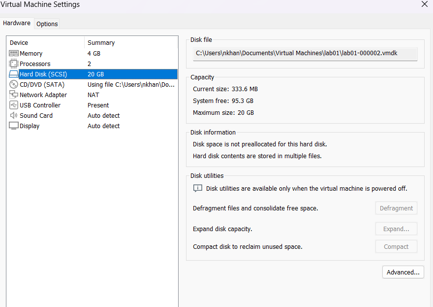
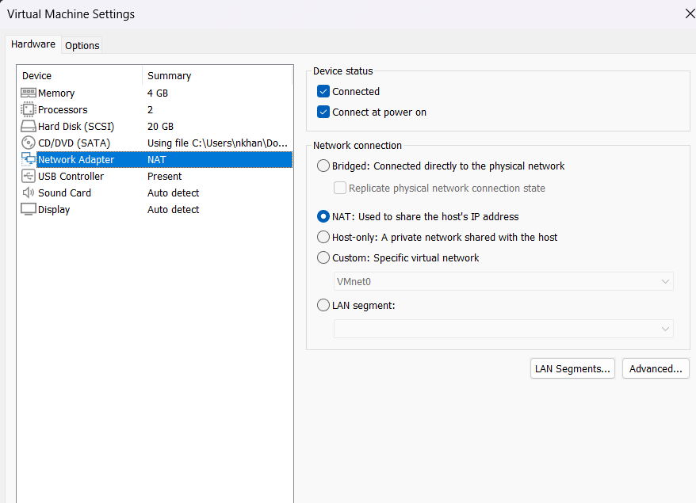

# Virtual Machine Build Document

This document provides step-by-step instructions for deploying a Linux test environment on Oracle VirtualBox. It is written so that a first-time administrator can rebuild the environment from scratch.

---

## Step 1. Initial Virtual Machine Setup
Open VirtualBox and click **Machine -> New**. Set the VM name to `Dev-Linux-Guest`, type to `Linux`, and version to `Ubuntu (64-bit)`. In the Hardware section, set Memory (RAM) to **2048 MB** (2 GB) and Processors to **2 vCPU**.



**Why 2048 MB RAM and 2 vCPU:** The host system has 16 GB of RAM total. Allocating 2 GB provides sufficient resources for a lightweight Linux development environment without starving the host operating system or causing system-wide memory swapping.

> **Check:** Ensure the total RAM allocated to all running virtual machines does not exceed 50% of the host system's physical memory.

---

## Step 2. Virtual Hard Disk Allocation
Under the Hard Disk settings tab, select **Create a Virtual Hard Disk Now**. Choose **VDI (VirtualBox Disk Image)** format and set storage allocation to **Dynamically Allocated** with a size limit of **20 GB**.



**Why Dynamically Allocated:** Fixed-size disks reserve all 20 GB on the physical SSD immediately. Dynamically allocated storage only expands on the host drive as files are actually created inside the guest, saving physical storage while allowing growth up to the 20 GB threshold.

> **Check:** Go to VM Settings -> Storage to verify that the virtual disk drive is attached to the SATA Controller with dynamic allocation enabled.

---

## Step 3. Network Adapter Configuration
In VM Settings, navigate to **Network -> Adapter 1**. Enable the network adapter and set **Attached to: NAT**.



**Why NAT and not Bridged:** The campus network filters connections by registered host MAC addresses. A Bridged adapter creates a distinct virtual MAC address which gets blocked by the network hardware. Behind NAT, all VM outbound network traffic shares the host's existing IP and MAC address, ensuring immediate internet connectivity.

> **Check:** Run `ip addr` inside the guest OS. You should see an IP address in the default `10.0.2.x` range, which is distinct from the host system's IP subnet.

---

## Step 4. Guest OS Kernel Verification
Power on the virtual machine, complete the standard Linux installer wizard, and open a terminal inside the guest environment. Run the kernel check command:

```bash
uname -a
